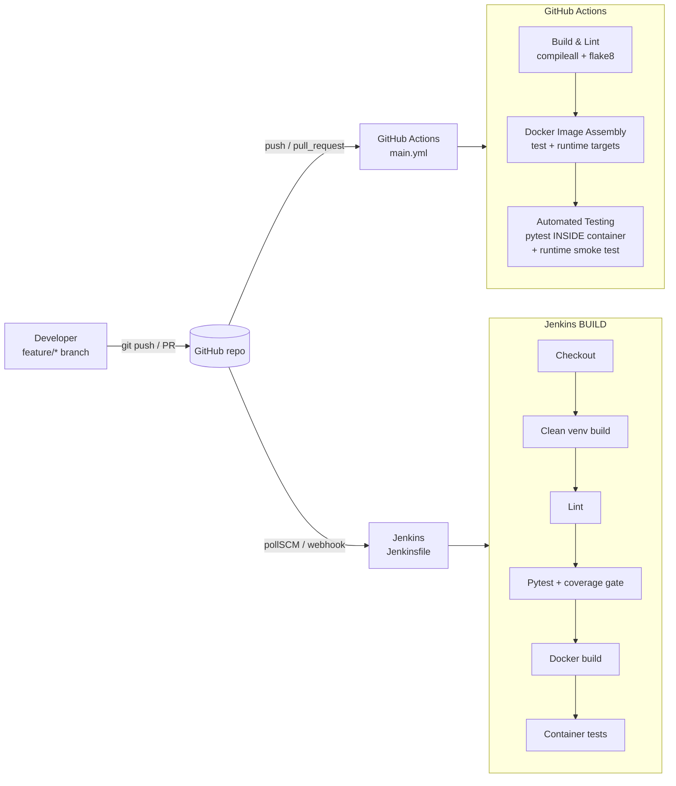

# ACEest Fitness & Gym — Automated CI/CD Pipeline

[](https://github.com/<your-github-username>/aceest-fitness-devops/actions/workflows/main.yml)


| | |
|---|---|
| **Student** | Bandgar Omkar Sudhakar Sheetal |
| **Roll No.** | 2025TM93075 |
| **Course** | Introduction to DevOps (CSIZG514 / SEZG514), S1-26 |
| **Assignment** | Assignment 1: Implementing Automated CI/CD Pipelines for ACEest Fitness & Gym |

ACEest Fitness & Gym is a Flask web application for managing gym clients, training programs,
nutrition targets, workouts and progress. This repository takes it from local development
through a Jenkins BUILD and quality gate, and a GitHub Actions pipeline that lints, containerises
and tests every push and pull request.

---

## Table of contents
1. [Architecture](#1-architecture)
2. [Application features](#2-application-features)
3. [Repository layout](#3-repository-layout)
4. [Local setup and execution](#4-local-setup-and-execution)
5. [Running the tests manually](#5-running-the-tests-manually)
6. [Docker](#6-docker)
7. [Jenkins BUILD and quality gate](#7-jenkins-build-and-quality-gate)
8. [GitHub Actions CI/CD](#8-github-actions-cicd)
9. [Version control strategy](#9-version-control-strategy)
10. [API reference](#10-api-reference)
11. [From the legacy desktop app to a web service](#11-from-the-legacy-desktop-app-to-a-web-service)

---

## 1. Architecture



**Application layers**

| Layer | File | Responsibility |
|---|---|---|
| Web / API | `app.py` | Flask app factory, routes, JSON error handling, HTML pages |
| Domain logic | `aceest/fitness.py` | Calories, BMI, adherence, membership and program generator (pure Python, no I/O) |
| Persistence | `aceest/database.py` | SQLite schema, per-request connections, admin seeding with hashed password |
| UI | `templates/`, `static/` | Server-rendered dashboard and client pages |

Keeping the business rules in a module with no Flask or database imports means they can be
unit-tested in isolation, while the API is tested end to end with Flask's test client.

## 2. Application features

- **Program catalogue**: Fat Loss (3-day and 5-day), Muscle Gain (PPL) and Beginner, each with a weekly workout plan, a diet plan and a calorie factor.
- **Calorie target**: body weight (kg) × program factor, recalculated automatically whenever weight or program changes.
- **BMI and risk**: WHO categories (Underweight, Normal, Overweight, Obese) with a coaching risk note.
- **Client management**: full CRUD with validation; duplicate names return `409 Conflict`.
- **Weekly adherence tracking**: 0–100 %, summarised as average, best and latest.
- **Workout logging**: types Strength, Hypertrophy, Cardio and Mobility, with nested exercises and total training volume (sets × reps × weight).
- **Body metrics**: weight, waist and body-fat history.
- **Membership status**: Active, Expiring Soon (7 days or fewer), Expired or No Membership, with days remaining.
- **Program generator**: suggests a training split, optionally for a chosen goal.
- **Authentication endpoint**: role-based users; passwords stored as salted hashes (Werkzeug).
- **Ops endpoints**: `/health` (also used by the Docker `HEALTHCHECK`) and `/api/version`.
- **Web dashboard**: site metrics, add-client form, client list, program cards and a per-client page with BMI, adherence bars and workout history.

## 3. Repository layout

```
aceest-fitness-devops/
├── app.py                     # Flask application (factory + routes)
├── aceest/
│   ├── __init__.py            # package version
│   ├── fitness.py             # business rules (pure functions)
│   └── database.py            # SQLite schema & connection handling
├── templates/                 # Jinja2 pages (base, index, client)
├── static/style.css
├── tests/
│   ├── conftest.py            # fixtures: isolated app + temp DB per test
│   ├── test_fitness.py        # unit tests for business logic
│   └── test_api.py            # API, validation, HTML and auth tests
├── requirements.txt           # runtime deps (pinned)
├── requirements-dev.txt       # + pytest, pytest-cov, flake8
├── Dockerfile                 # multi-stage: builder → test → runtime
├── .dockerignore
├── docker-compose.yml         # one-command local run
├── Jenkinsfile                # Jenkins declarative pipeline
├── jenkins/                   # Jenkins-in-Docker for the lab (python3 + docker CLI)
├── .github/workflows/main.yml # GitHub Actions pipeline
├── .flake8 / pytest.ini       # tool configuration
└── legacy/                    # original Tkinter versions v1.0 → v3.2.4 (reference only)
```

## 4. Local setup and execution

**Prerequisites:** Python 3.10 or newer (3.12 recommended), Git, and optionally Docker.

```bash
# 1. Clone
git clone https://github.com/<your-github-username>/aceest-fitness-devops.git
cd aceest-fitness-devops

# 2. Create and activate a virtual environment
python -m venv .venv
source .venv/bin/activate          # Windows: .venv\Scripts\activate

# 3. Install dependencies
pip install -r requirements-dev.txt

# 4. Run the development server
python app.py
# → http://127.0.0.1:5000
```

Production-style run with Gunicorn (Linux/macOS):

```bash
gunicorn --bind 0.0.0.0:5000 --workers 2 "app:create_app()"
```

**Configuration** (environment variables):

| Variable | Default | Purpose |
|---|---|---|
| `DATABASE_PATH` | `instance/aceest_fitness.db` | SQLite file location |
| `SECRET_KEY` | `dev-only-change-me` | Flask session signing; **set this in production** |
| `ADMIN_USER` / `ADMIN_PASSWORD` | `admin` / `admin` | Seeded admin account (first start only) |
| `HOST` / `PORT` / `FLASK_DEBUG` | `127.0.0.1` / `5000` / off | Dev server only |

Quick API check:

```bash
curl http://127.0.0.1:5000/health
curl -X POST http://127.0.0.1:5000/api/clients \
     -H "Content-Type: application/json" \
     -d '{"name":"Arjun","age":30,"height":180,"weight":80,"program":"fat-loss-3day","membership_end":"2026-12-31"}'
curl http://127.0.0.1:5000/api/clients/1/summary
```

## 5. Running the tests manually

```bash
source .venv/bin/activate

pytest                                   # all 93 tests
pytest -v tests/test_fitness.py          # business-logic unit tests only
pytest -k membership                     # filter by keyword
pytest --cov=app --cov=aceest --cov-report=term-missing   # with coverage (~99%)
flake8 app.py aceest tests               # lint
```

Run the same suite inside the container, exactly as CI does:

```bash
docker build --target test -t aceest-fitness:test .
docker run --rm aceest-fitness:test
```

**What is covered**

| Area | Examples |
|---|---|
| Calculations | calorie factors for every program, BMI value and category boundaries (18.5 / 25 / 30) |
| Validation | negative or non-numeric input, unknown programs, bad dates, adherence outside 0–100, non-JSON bodies |
| CRUD | create, read, update with calorie recalculation, delete with cascade, `404`, `409` duplicates |
| Tracking | progress, workouts with nested exercises, body metrics, summary aggregation |
| Security | login success and failure, password stored as a hash |
| UI | dashboard and client pages render; form create, validation and duplicate messages |

Each test gets its own temporary SQLite database (`tmp_path` fixture), so tests are isolated and can run in any order.

## 6. Docker

The `Dockerfile` is a **multi-stage build**:

| Stage | Purpose |
|---|---|
| `builder` | Creates `/opt/venv` and installs only runtime dependencies. `requirements.txt` is copied before the source so this layer stays cached when only code changes. |
| `test` | `builder` plus dev tools and `tests/`. CI and Jenkins run Pytest here. |
| `runtime` (default) | `python:3.12-slim`, copies only the venv and the app code. No compilers, tests or pip cache. |

Size and security choices:
- Slim base image, `PIP_NO_CACHE_DIR`, no bytecode files, and a strict `.dockerignore` (no `.git`, tests, legacy code or local DBs in the context).
- Runs as **non-root user `aceest` (UID 10001)**. Application files are owned by root and read-only to that user; only `/app/instance` (the data volume) is writable.
- Gunicorn instead of the Flask dev server; a `HEALTHCHECK` on `/health`.
- Secrets are supplied through environment variables, never baked into the image.
- The Dockerfile passes `hadolint` with no warnings.

```bash
docker build -t aceest-fitness:latest .
docker run -d -p 5000:5000 -v aceest_data:/app/instance --name aceest aceest-fitness:latest
docker ps                 # STATUS shows (healthy) after start-up
# or simply:
docker compose up --build
```

## 7. Jenkins BUILD and quality gate

Jenkins is the second validation layer: it pulls the latest code from GitHub and performs a
**clean build** in a controlled environment, so the code is checked independently of a
developer's machine and of GitHub's runners.

### Setup (lab)

```bash
docker compose -f jenkins/docker-compose.yml up -d --build
docker exec aceest-jenkins cat /var/jenkins_home/secrets/initialAdminPassword
```

1. Open `http://localhost:8080`, unlock Jenkins and install the suggested plugins (these include Pipeline, Git and JUnit).
2. **New Item → Pipeline** and name it `aceest-fitness-build`.
3. Under *Pipeline*, choose **Pipeline script from SCM**, set SCM to **Git**, enter the repository URL, use branch `*/main` and script path `Jenkinsfile`.
4. Save, then click **Build Now**. Later builds start automatically through `pollSCM` (every ~5 minutes). For instant builds, add a GitHub webhook to `http://<jenkins-host>/github-webhook/` and tick *GitHub hook trigger for GITScm polling*.

### Pipeline logic (`Jenkinsfile`)

| Stage | What it does | Fails the build when |
|---|---|---|
| Checkout | `checkout scm` pulls the commit from GitHub | repository is unreachable |
| Clean Build Environment | deletes and recreates `.venv`, installs pinned deps, `compileall` | a dependency or syntax error |
| Lint | `flake8` | any style or logic warning |
| Unit Tests | Pytest with JUnit XML and coverage; **gate: coverage of at least 90 %** | a failing test or coverage below 90 % |
| Docker Build | builds the `test` and `runtime` images, tagged with `BUILD_NUMBER` | Dockerfile errors |
| Container Tests | runs Pytest inside the image, starts the runtime container and checks `/health` | the container is unhealthy |

Post-build: JUnit results are published to the Jenkins test-trend graph, reports are archived,
old builds are rotated, concurrent builds are disabled, and a 20-minute timeout applies.

## 8. GitHub Actions CI/CD

Workflow: `.github/workflows/main.yml`, triggered on **every `push`** (all branches), on
**`pull_request`** into `main`/`develop`, and manually through `workflow_dispatch`.

```
build-lint ──► docker-build ──► docker-test
```

| Job | Steps |
|---|---|
| **Build & Lint** | checkout → Python 3.12 (pip cache) → install deps → `python -m compileall` (syntax check) → `flake8` → confirm the app factory boots |
| **Docker Image Assembly** | build the `test` and `runtime` targets → tag with the commit SHA → hand the images to the next job as an artifact |
| **Automated Testing** | load the images → **run Pytest inside the container** (JUnit and coverage XML, coverage of at least 90 %) → start the runtime container, poll `/health`, call `/api/programs`, assert it runs as non-root → upload test reports |

Other details: least-privilege `permissions: contents: read`, and `concurrency` cancels stale runs
on the same branch. Each job depends on the previous one, so a lint failure stops the pipeline
before any image is built.

**How the two tools fit together:** GitHub Actions gives fast feedback on every push and PR,
and its status check can be required before merging into `main`. Jenkins runs the same quality
gates in a self-managed build environment, which is the controlled BUILD phase the assignment
asks for. Both use the same `requirements-dev.txt`, `flake8` config, test suite and Dockerfile
targets, so a build that is green in one is green in the other.

## 9. Version control strategy

**Branching (Git Flow, simplified)**

| Branch | Purpose |
|---|---|
| `main` | Released, deployable code; tagged releases (`v1.0.0`) |
| `develop` | Integration branch for completed features |
| `feature/*` | New functionality, e.g. `feature/flask-app`, `feature/test-suite` |
| `infra/*` | Docker and CI/CD changes, e.g. `infra/docker`, `infra/ci-cd` |
| `fix/*` | Bug fixes, e.g. `fix/admin-seed-race` |

Feature branches are merged into `develop` with `--no-ff`, so each feature stays visible as a
unit in history. `develop` is merged into `main` for a release and tagged.

**Commit messages** follow [Conventional Commits](https://www.conventionalcommits.org/):
`feat:`, `fix:`, `test:`, `build:`, `ci:`, `docs:`, `chore:`, `refactor:`, for example:

```
feat(api): add client CRUD with calorie recalculation
fix(db): make admin seeding safe for concurrent gunicorn workers
ci: add GitHub Actions pipeline with in-container pytest
```

View the history with `git log --oneline --graph --all`.

## 10. API reference

| Method | Endpoint | Description |
|---|---|---|
| GET | `/` | Web dashboard |
| GET | `/clients/<id>` | Client detail page |
| POST | `/clients` | Add a client (HTML form) |
| GET | `/health` | Liveness and DB check |
| GET | `/api/version` | App version |
| GET | `/api/programs` · `/api/programs/<id>` | Program catalogue |
| POST | `/api/calculate/calories` | `{weight, program}` → kcal/day |
| POST | `/api/calculate/bmi` | `{weight, height}` → BMI, category, risk |
| POST | `/api/auth/login` | `{username, password}` → role |
| GET / POST | `/api/clients` | List or create clients |
| GET / PUT / DELETE | `/api/clients/<id>` | Read, update or delete a client |
| GET | `/api/clients/<id>/summary` | BMI, adherence stats, membership, workout count |
| POST | `/api/clients/<id>/generate-program` | Optional `{goal}` → suggested split |
| GET / POST | `/api/clients/<id>/progress` | Weekly adherence |
| GET / POST | `/api/clients/<id>/workouts` | Workouts with nested `exercises` |
| GET / POST | `/api/clients/<id>/metrics` | Body metrics |

Errors are always JSON: `400` validation, `401` bad credentials, `404` not found, `409` duplicate.

Program IDs: `fat-loss-3day`, `fat-loss-5day`, `muscle-gain-ppl`, `beginner`.

## 11. From the legacy desktop app to a web service

The baseline code was a series of Tkinter desktop scripts (kept unchanged in `legacy/`).
Their logic was consolidated into the Flask service:

| Legacy version | Feature carried forward |
|---|---|
| v1.0 | Program catalogue (workout and diet plans), site metrics |
| v1.1 / v1.1.2 | Calorie factor per program |
| v2.0.1 – v2.2.1 | SQLite clients and weekly adherence tracking |
| v2.2.4 / v3.0.1 | Workouts, exercises, body metrics, BMI and risk, extra program variants |
| v3.1.2 / v3.2.4 | Users and roles, membership status, program generator |

Improvements over the legacy code: a headless HTTP API instead of a GUI (so it can be
containerised and tested), hashed passwords instead of plain text, input validation, foreign
keys with cascade deletes, and business logic separated from I/O so it can be tested.

---

**Author:** Bandgar Omkar Sudhakar Sheetal · Roll No. 2025TM93075 · BITS Pilani WILP
