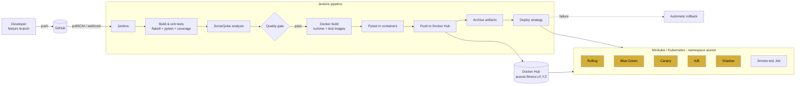

# ACEest Fitness & Gym — End-to-End DevOps CI/CD

[](https://github.com/2025tm93075-sys/aceest-fitness-devops-latest/actions/workflows/main.yml)


| | |
|---|---|
| **Student** | Bandgar Omkar Sudhakar Sheetal |
| **Roll No.** | 2025TM93075 |
| **Course** | Introduction to DevOps (CSIZG514 / SEZG514) |
| **Assignments** | 1: Automated CI/CD pipelines · 2: DevOps CI/CD implementation with Kubernetes deployment strategies |
| **GitHub** | https://github.com/2025tm93075-sys/aceest-fitness-devops-latest |
| **Docker Hub** | `https://hub.docker.com/r/<dockerhub-user>/aceest-fitness` |

ACEest Fitness & Gym is a Flask web application for managing gym clients, training programs,
nutrition targets, workouts and progress. Every commit is tested, analysed by SonarQube,
packaged as a Docker image, pushed to Docker Hub and released to Kubernetes with one of five
progressive deployment strategies. Every strategy reverts automatically to the last stable
version when a release fails.

---

## Table of contents
1. [Assignment 2 deliverables](#1-assignment-2-deliverables)
2. [Architecture](#2-architecture)
3. [Application versions](#3-application-versions)
4. [Repository layout](#4-repository-layout)
5. [Run locally](#5-run-locally)
6. [Tests](#6-tests)
7. [Docker and Docker Hub](#7-docker-and-docker-hub)
8. [Jenkins and SonarQube setup](#8-jenkins-and-sonarqube-setup)
9. [Jenkins pipeline](#9-jenkins-pipeline)
10. [Kubernetes deployment strategies](#10-kubernetes-deployment-strategies)
11. [Rollback](#11-rollback)
12. [Public endpoint for submission](#12-public-endpoint-for-submission)
13. [GitHub Actions](#13-github-actions)
14. [Version control strategy](#14-version-control-strategy)
15. [API reference](#15-api-reference)
16. [Submission checklist](#16-submission-checklist)

---

## 1. Assignment 2 deliverables

| Requirement | Where |
|---|---|
| Flask application (`ACEest_Fitness.py` and versions) | `ACEest_Fitness.py`, `app.py`, `aceest/`, `templates/`, `static/`; releases tagged `v1.0.0`, `v1.1.0`, `v1.2.0`; original scripts in `legacy/` |
| Git and GitHub: commits, branches, tags | `feature/*`, `infra/*`, `fix/*` → `develop` → `main`, annotated tags (see [section 14](#14-version-control-strategy)) |
| Pytest unit tests and automation | `tests/` (unit and integration), `tests/smoke/` (post-deployment) |
| Jenkins build server with SCM polling | `Jenkinsfile` (`pollSCM('H/2 * * * *')` plus GitHub webhook), `jenkins/` |
| Build artifacts per version | Jenkins archives `dist/aceest-fitness-<version>-b<build>-{src,k8s}.tar.gz` and `build-info.json` |
| Docker image, versioned on Docker Hub | `Dockerfile`; tags `vX.Y.Z`, `vX.Y.Z-b<build>`, `latest`; `k8s/scripts/publish-all-versions.sh` |
| Kubernetes manifests | `k8s/*.yaml` |
| Rolling update, blue-green, canary, shadow, A/B testing | `k8s/10-…` to `k8s/50-…` and `k8s/scripts/` |
| Rollback to last stable version | Automatic in every script and in the Jenkins `post { failure }` block; `k8s/scripts/rollback.sh` |
| Pytest inside containers to validate each deployment | Jenkins "Tests in Containers" stage, plus the `k8s/jobs/smoke-test.yaml` Job run in the cluster after every release |
| SonarQube static analysis and quality gate | `sonar-project.properties`, Jenkins stages "SonarQube Analysis" and "Quality Gate" |

## 2. Architecture



Traffic reaches the cluster through the NGINX ingress controller (canary weights, A/B
header and cookie routing, request mirroring for shadow) and through NodePorts for the
rolling and blue-green environments.

## 3. Application versions

| Tag | Main changes | Docker Hub image |
|---|---|---|
| `v1.0.0` | Flask rewrite of the Tkinter app: clients, programs, calories, BMI, progress, workouts, metrics, auth | `aceest-fitness:v1.0.0` |
| `v1.1.0` | Kubernetes-ready: `/ready` probe, deployment metadata (`X-App-Version`, `X-Deployment-Track`, `X-Pod` headers and page banner), fault injection for rollback drills, `ACEest_Fitness.py` entry point, OCI image labels | `aceest-fitness:v1.1.0` |
| `v1.2.0` | One-rep max estimator (API and `/tools` page), variant B dashboard promo for A/B testing, generated secrets instead of hard-coded defaults, Kubernetes manifests, SonarQube and the CD pipeline | `aceest-fitness:v1.2.0` |

The version lives in `aceest/__init__.py`; Jenkins reads it to tag images and artifacts.

## 4. Repository layout

```
├── ACEest_Fitness.py          # WSGI entry point (gunicorn ACEest_Fitness:app)
├── app.py                     # Flask app factory and routes
├── aceest/                    # fitness logic, database, deployment metadata, secrets
├── templates/ static/         # dashboard, client page, tools page
├── tests/                     # unit and integration tests (Flask test client)
│   └── smoke/                 # post-deployment tests against a live URL
├── Dockerfile                 # builder → test → runtime (non-root, healthcheck)
├── Jenkinsfile                # CI/CD pipeline
├── sonar-project.properties   # SonarQube configuration
├── jenkins/                   # Jenkins + SonarQube stack, plugins, kubeconfig helper
├── k8s/
│   ├── 00-namespace.yaml
│   ├── 10-rolling-update.yaml
│   ├── 20-blue-green.yaml
│   ├── 30-canary.yaml
│   ├── 40-ab-testing.yaml
│   ├── 50-shadow.yaml
│   ├── jobs/smoke-test.yaml   # Pytest smoke suite as a Kubernetes Job
│   └── scripts/               # bootstrap, release, rollback, status, traffic checks
├── .github/workflows/main.yml # GitHub Actions (Assignment 1)
└── legacy/                    # original Tkinter versions v1.0 → v3.2.4
```

## 5. Run locally

```bash
git clone https://github.com/2025tm93075-sys/aceest-fitness-devops-latest.git
cd aceest-fitness-devops-latest
python -m venv .venv && source .venv/bin/activate      # Windows: .venv\Scripts\activate
pip install -r requirements-dev.txt
python ACEest_Fitness.py                               # http://127.0.0.1:5000
```

| Variable | Default | Purpose |
|---|---|---|
| `DATABASE_PATH` | `instance/aceest_fitness.db` | SQLite file |
| `SECRET_KEY`, `ADMIN_PASSWORD` | generated once into the instance folder | Session signing and admin login; Kubernetes injects them from a Secret |
| `ADMIN_USER` | `admin` | Seeded admin account |
| `DEPLOYMENT_TRACK` | `local` | Shown in the banner, `X-Deployment-Track` and `/api/version` |
| `UI_VARIANT` | `A` | `B` shows the one-rep max promo (A/B test) |
| `FAULT_INJECTION` | unset | `health` makes `/health` and `/ready` return 503 (rollback drill) |

## 6. Tests

```bash
pytest                                             # 134 pass; the 7 smoke tests skip without a URL
pytest --cov=app --cov=aceest --cov-report=term    # about 99% coverage
flake8 app.py ACEest_Fitness.py aceest tests

# Smoke suite against any running instance
SMOKE_BASE_URL=http://127.0.0.1:5000 SMOKE_EXPECT_VERSION=1.2.0 pytest tests/smoke
```

| Level | Runs where | What it proves |
|---|---|---|
| Unit and integration (`tests/`) | Jenkins workspace and inside the test image | Business rules, API, validation, UI, auth, deployment metadata, secrets |
| Container smoke (`tests/smoke`) | Test container calling the runtime container on a Docker network | The image that will be shipped starts, serves the right version and runs as UID 10001 |
| Cluster smoke (`k8s/jobs/smoke-test.yaml`) | Kubernetes Job inside the cluster, after every release step | The Service being promoted answers with the expected version and track; failure triggers rollback |

## 7. Docker and Docker Hub

Multi-stage `Dockerfile`: `builder` (venv with runtime deps) → `test` (adds pytest and the
tests) → `runtime` (python:3.12-slim, non-root UID 10001, Gunicorn, `HEALTHCHECK`, OCI labels
with version and commit). Podman builds it unchanged (`podman build .`).

Images pushed by Jenkins for every build:

```
docker.io/<dockerhub-user>/aceest-fitness:v1.2.0         # release
docker.io/<dockerhub-user>/aceest-fitness:v1.2.0-b17     # exact build
docker.io/<dockerhub-user>/aceest-fitness:latest
docker.io/<dockerhub-user>/aceest-fitness-test:v1.2.0    # test image used by the smoke Job
```

To publish **every** tagged version (v1.0.0, v1.1.0, v1.2.0) in one go:

```bash
docker login
IMAGE_REPO=docker.io/<dockerhub-user>/aceest-fitness k8s/scripts/publish-all-versions.sh
```

## 8. Jenkins and SonarQube setup

Prerequisites: Docker, Minikube, kubectl, and a Docker Hub account with an
[access token](https://hub.docker.com/settings/security).

```bash
# 1. Cluster (creates the "minikube" Docker network that Jenkins joins)
k8s/scripts/minikube-up.sh

# 2. Jenkins + SonarQube + PostgreSQL
sudo sysctl -w vm.max_map_count=524288        # Linux only, required by SonarQube
docker compose -f jenkins/docker-compose.yml up -d --build
docker exec aceest-jenkins cat /var/jenkins_home/secrets/initialAdminPassword

# 3. Kubeconfig that works from inside the Jenkins container
jenkins/make-kubeconfig.sh                    # writes jenkins/kubeconfig-minikube.yaml (git-ignored)
```

**SonarQube** (http://localhost:9000, first login admin/admin):
1. *My Account → Security*: generate a **global analysis token**.
2. *Administration → Configuration → Webhooks*: add `http://aceest-jenkins:8080/sonarqube-webhook/` (lets Jenkins wait for the quality gate).

**Jenkins** (http://localhost:8080; the plugins in `jenkins/plugins.txt` are pre-installed):
1. *Manage Jenkins → Credentials → Global*, add:
   - `dockerhub-creds`: Username with password (Docker Hub user and access token)
   - `minikube-kubeconfig`: Secret file (`jenkins/kubeconfig-minikube.yaml`)
   - `sonar-token`: Secret text (the SonarQube token)
2. *Manage Jenkins → System → SonarQube servers*: name **`SonarQube`**, URL `http://aceest-sonarqube:9000`, token `sonar-token`.
3. *Manage Jenkins → Tools → SonarQube Scanner installations*: name **`SonarScanner`**, install automatically.
4. *New Item → Pipeline* `aceest-fitness-cicd`: *Pipeline script from SCM*, Git, `https://github.com/2025tm93075-sys/aceest-fitness-devops-latest.git`, branch `*/main`, script path `Jenkinsfile`.
5. In the `Jenkinsfile`, set `DOCKERHUB_USER` to your Docker Hub username and push.
6. Click **Build Now** once (Jenkins reads the parameters and the polling trigger). From then on, every push to `main` is picked up within two minutes. For instant builds, add a GitHub webhook to `http://<public-jenkins-url>/github-webhook/`.

## 9. Jenkins pipeline

| # | Stage | What happens | Stops the pipeline when |
|---|---|---|---|
| 1 | Checkout | Pulls the commit, reads the version, names the build `#N vX.Y.Z (sha)` | `DOCKERHUB_USER` is not set |
| 2 | Build & Unit Tests | Clean venv, compileall, flake8 (report for Sonar), Pytest with JUnit and coverage XML | A lint error, a failing test, or coverage below 90% |
| 3 | SonarQube Analysis | `sonar-scanner` with coverage, test and flake8 reports | Scanner error |
| 4 | Quality Gate | Waits for the SonarQube webhook | The gate fails |
| 5 | Docker Build | Runtime image (`vX.Y.Z`, `vX.Y.Z-bN`, `latest`) and test image | Build error |
| 6 | Tests in Containers | Full suite inside the test image; smoke suite from the test container against the runtime container; checks non-root UID | Any test fails |
| 7 | Push to Docker Hub | Pushes all tags of both images | Login or push fails |
| 8 | Build Artifacts | Source tarball, manifests tarball, `build-info.json` with image digest, all fingerprinted | — |
| 9 | Deploy to Kubernetes | Bootstraps all strategies on first run, then releases with `DEPLOY_STRATEGY` | Rollout or in-cluster smoke test fails → **automatic rollback** |

Build parameters: `DEPLOY_STRATEGY` (`rolling` by default for polled builds, or `blue-green`,
`canary`, `ab-test`, `shadow`, `all`, `none`), `CANARY_WEIGHT`, `PROMOTE`, `SIMULATE_FAILURE`
(rollback drill), `PUSH_IMAGES`.

## 10. Kubernetes deployment strategies

```bash
export IMAGE_REPO=docker.io/<dockerhub-user>/aceest-fitness
STABLE_TAG=v1.1.0 NEW_TAG=v1.2.0 k8s/scripts/bootstrap.sh    # all five strategies
k8s/scripts/status.sh
```

Add the hosts line printed by `minikube-up.sh` (`<minikube-ip> rolling.aceest.local …`) to
`/etc/hosts`.

| Strategy | Endpoint | Release | Rollback |
|---|---|---|---|
| **Rolling update** | `http://<minikube-ip>:30080` · `rolling.aceest.local` | `rolling-update.sh v1.2.0` | automatic; or `rollback.sh rolling` |
| **Blue-green** | live `:30081` · preview `:30082` · `bluegreen.aceest.local` | `blue-green.sh deploy v1.2.0` | `blue-green.sh rollback` (instant) |
| **Canary** | `canary.aceest.local` | `canary.sh start v1.2.0 20` → `canary.sh weight 50` → `canary.sh promote` | `canary.sh abort` |
| **A/B testing** | `ab.aceest.local` | `ab-test.sh deploy v1.2.0` → `ab-test.sh split 50` → `ab-test.sh results` | `ab-test.sh end` |
| **Shadow** | `shadow.aceest.local` | `shadow.sh deploy v1.2.0` → `shadow.sh compare` → `shadow.sh promote` | `shadow.sh stop` |

How each one works:

- **Rolling update:** 3 replicas, `maxSurge: 1`, `maxUnavailable: 0`, plus a PodDisruptionBudget. A new pod gets traffic only after `/ready` passes, so capacity never drops.
- **Blue-green:** `aceest-blue` and `aceest-green` run side by side. The live Service selects `slot: blue|green` and the preview Service exposes the idle slot. The new version goes to the idle slot, is smoke-tested through the preview Service, then the live selector is switched in one API call. The previous slot is recorded, so rollback is one more switch.
- **Canary:** stable (3 replicas) and canary (1 replica). An NGINX canary ingress sends `canary-weight`% of requests to the canary. The header `X-Canary: always` forces the canary for QA.
- **A/B testing:** two deployments of the same release with `UI_VARIANT=A` and `B`. New visitors are split 50/50. The cookie `ab_variant=always` or the header `X-Variant: B` pins a user to variant B. `ab-test.sh results` compares promo clicks per variant from the access logs.
- **Shadow:** users are served only by production. The ingress `mirror-target` copies every request to the shadow release and discards its response. `shadow.sh compare` shows requests and 5xx counts for both.

See the split with your own eyes:

```bash
k8s/scripts/traffic-check.sh canary.aceest.local 100           # ~80 x v1.1.0 (stable), ~20 x v1.2.0 (canary)
k8s/scripts/traffic-check.sh ab.aceest.local 20 -H "X-Variant: B"
curl -sI -H "Host: bluegreen.aceest.local" http://$(minikube ip)/ | grep X-
```

## 11. Rollback

| Failure | What happens |
|---|---|
| New pods never become ready (crash, bad image, failing `/ready`) | `kubectl rollout status` times out → `rollout undo --to-revision=<last stable>`; old pods kept serving the whole time |
| Release is up but the in-cluster smoke Job fails | The script reverts the deployment (rolling, canary promote, shadow promote), keeps the old slot live (blue-green), or sets the weight back to 0 (canary, A/B) |
| Any later pipeline stage fails | Jenkins `post { failure }` runs `k8s/scripts/rollback.sh <strategy>` |
| Manual | `k8s/scripts/rollback.sh <rolling\|blue-green\|canary\|ab-test\|shadow\|all>` or `kubectl -n aceest rollout undo deployment/<name>` |

**Rollback drill** (good for a demo screenshot): run the Jenkins job with `SIMULATE_FAILURE=true`,
or locally `FAULT_INJECTION=health k8s/scripts/rolling-update.sh v1.2.0`. The new pods report
503, never become ready, users keep being served by the old pods, and the deployment returns
to the stable revision. `kubectl -n aceest rollout history deployment/aceest-rolling` shows it.

## 12. Public endpoint for submission

Minikube runs on your machine, so its IP is not reachable from outside. Options:

1. **Tunnel the ingress** (simplest): `minikube tunnel`, then
   `cloudflared tunnel --url http://localhost:80 --http-host-header canary.aceest.local`
   (or `ngrok http 80 --host-header=canary.aceest.local`). Repeat per host you want to share.
2. **Cloud cluster:** the same manifests run unchanged on EKS, AKS or GKE after installing
   ingress-nginx. Point a DNS name (or the load balancer hostname) at the ingress and replace
   `*.aceest.local` in `k8s/*.yaml`.

## 13. GitHub Actions

`.github/workflows/main.yml` (from Assignment 1) still runs on every push and pull request:
Build & Lint → Docker image assembly → Pytest inside the container and a runtime smoke test.
It gives fast feedback on branches, while Jenkins owns the release path.

## 14. Version control strategy

| Branch | Purpose | Examples |
|---|---|---|
| `main` | Released code, annotated tags | `v1.0.0`, `v1.1.0`, `v1.2.0` |
| `develop` | Integration | |
| `feature/*` | Application features | `feature/k8s-ready-app`, `feature/one-rep-max`, `feature/ab-variant` |
| `infra/*` | Pipeline and platform | `infra/kubernetes`, `infra/sonarqube-jenkins-cd` |
| `fix/*` | Bug and security fixes | `fix/admin-seed-race`, `fix/sonar-security-hotspots` |

Merges use `--no-ff`; commit messages follow Conventional Commits (`feat`, `fix`, `test`,
`ci`, `build`, `docs`, `chore`). View the history with `git log --oneline --graph --all`.

## 15. API reference

| Method | Endpoint | Description |
|---|---|---|
| GET | `/` · `/clients/<id>` · `/tools` | Dashboard, client page, strength tools |
| GET | `/health` · `/ready` | Liveness and readiness probes |
| GET | `/api/version` | Version, track, UI variant and pod |
| GET | `/api/programs[/<id>]` | Program catalogue |
| POST | `/api/calculate/calories` · `/bmi` · `/one-rep-max` | Calculators |
| POST | `/api/auth/login` | Credential check |
| GET/POST | `/api/clients` | List or create clients |
| GET/PUT/DELETE | `/api/clients/<id>` | Read, update or delete a client |
| GET | `/api/clients/<id>/summary` | BMI, adherence, membership |
| GET/POST | `/api/clients/<id>/progress` · `/workouts` · `/metrics` | Tracking |
| POST | `/api/clients/<id>/generate-program` | Suggested split |

Every response carries `X-App-Version`, `X-Deployment-Track`, `X-UI-Variant` and `X-Pod`.

> Each pod keeps its own SQLite database (an `emptyDir` volume), which is enough to demonstrate
> the strategies. A production rollout would move client data to a shared database such as
> PostgreSQL so all replicas see the same records.

## 16. Submission checklist

- [ ] Set `DOCKERHUB_USER` in `Jenkinsfile` and push to `main`
- [ ] Run `publish-all-versions.sh` so Docker Hub has `v1.0.0`, `v1.1.0`, `v1.2.0`
- [ ] Jenkins: green runs for recent commits (Stage View screenshot), artifacts archived
- [ ] SonarQube: project dashboard showing the quality gate passed (screenshot or PDF export)
- [ ] Cluster: `k8s/scripts/status.sh` output and the `traffic-check.sh` results for each strategy
- [ ] Rollback drill screenshot (`SIMULATE_FAILURE=true` build)
- [ ] Public endpoint URL(s) from [section 12](#12-public-endpoint-for-submission)

---

**Author:** Bandgar Omkar Sudhakar Sheetal · Roll No. 2025TM93075 · BITS Pilani WILP
